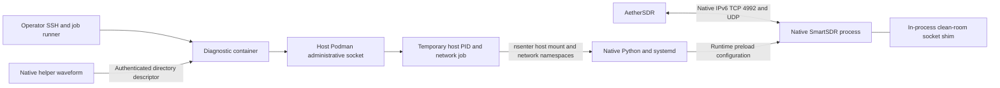

# Reconstructing the working native IPv6 arrangement

This is the complete source arrangement that produced native IPv6 control,
meters, audio, spectrum and waterfall with AetherSDR on a FLEX-8600M running
SmartSDR 4.2.18.41174. Credentials and generated private waveform executables
are operator inputs; no existing radio address, private key or token is shared.
The publication adds configurable paths and a required reviewed shim digest
to the tested execution mechanism. Those adaptations are tested locally;
the original live evidence is in [EVIDENCE.md](EVIDENCE.md).



The diagnostic container does not translate radio packets. The native helper
provides a deliberately authenticated administration bridge; the runner removes
its temporary job container and host work directory. SmartSDR owns the converted
kernel sockets, and the client sends/receives directly over the radio's Ethernet.

## 1. Build private access packages and the shim

Run these commands from `tools/flex-native-ipv6/`. Set `PRIVATE` to a new path
outside the checkout. Build the legacy native helper first; this generates the
private directory, token and waveform package, and runs the original Go tests.

```sh
PRIVATE="$HOME/flex-native-private"
python3 native-waveform/build.py --output-dir "$PRIVATE"
ssh-keygen -t ed25519 -f "$PRIVATE/ssh-key" -C flex-native-diagnostic
cp "$PRIVATE/ssh-key.pub" diagnostic-container/authorized_keys

docker buildx build --platform linux/arm64 --provenance=false \
  --output "type=oci,compression=gzip,dest=$PRIVATE/nereus-net-probe.oci.tar" \
  diagnostic-container
gzip "$PRIVATE/nereus-net-probe.oci.tar"

mkdir "$PRIVATE/shim"
docker run --rm --platform linux/arm64 --network none --read-only \
  --cap-drop ALL --security-opt no-new-privileges --tmpfs /tmp:exec \
  --tmpfs /work:exec -v "$PWD/shim:/source:ro" -v "$PRIVATE/shim:/out" \
  -w /work gcc:13 sh -c 'cp -R /source/. /work/ && make all && cp libnereus_ipv6.so /out/'
SHIM_SHA=$(shasum -a 256 "$PRIVATE/shim/libnereus_ipv6.so" | cut -d ' ' -f 1)
```

Retain the helper token and compiled native package privately. The SSH image
contains only the dedicated public key. The shim is Linux/glibc ARM64, separate
from the Alpine/musl diagnostic image. Run the isolated fixture suite in
[shim/README.md](shim/README.md) before deployment; it includes real IPv6 sockets
and simultaneous internal/external traffic. The full fixture suite changes only
its isolated container loopback interface.

## 2. Install the diagnostic container and establish SSH trust

Use the radio's SmartSDR Waveforms manager, Docker installation, and select the
compressed `nereus-net-probe.oci.tar.gz` intact. This shape was accepted as
`nereus-net-probe` without a modulation mode on the tested firmware. Set
`RADIO_ADDRESS` to the reachable processor address, initially over IPv4.

```sh
RADIO_ADDRESS=RADIO_PROCESSOR_ADDRESS
ssh -o IdentitiesOnly=yes -o UserKnownHostsFile="$PRIVATE/known-hosts" \
  -i "$PRIVATE/ssh-key" -p 22222 "root@$RADIO_ADDRESS" net-report
```

Compare the SSH fingerprint with the container startup log before accepting it.
Subsequent runner calls require this pinned known-hosts file and strict checking.
The measured radio deployment shared the host network namespace. The internal
CPU/FPGA pair was `172.30.1.1` / `172.30.1.2`; an advertised `172.16.x.x` or other
processor subnet is not automatically reachable from the client LAN.

Root here initially means container root. Host administration comes from the
native helper's authenticated root-directory descriptor and the native Podman
socket, not from SSH itself. The helper's native UID must match the measured
78666 and its Unix-socket peer must be root. Different firmware needs a fresh
inspection rather than a guessed change to those checks.

Define this shell function for the operator runner. Each call uploads/restarts
the private native helper as needed; its 60-second lifetime is intentional.

```sh
native_job() {
  python3 operator/native-run.py "$@" \
    --host "$RADIO_ADDRESS" --ssh-key "$PRIVATE/ssh-key" \
    --known-hosts "$PRIVATE/known-hosts" \
    --token-file "$PRIVATE/client-token.txt" \
    --native-package "$PRIVATE/NereusNativeProbe.ssdr_waveform" \
    --state-dir "$PRIVATE/operator-state"
}
```

The runner creates a temporary privileged host-PID/host-network container via
the administrative socket, enters host mount/network namespaces with `nsenter`,
and runs native `/usr/bin/python3`. The receiver, temporary native files and
job container are removed. Native job source is trusted operator input.

## 3. Enable the native Linux IPv6 stack

The measured boot blocker was `ipv6.disable=1` in `/boot/cmdline.txt`.
`deployment/native-ipv6-host-edit.py` checks the entire original command line
and read-only `/boot` mount/device, creates a backup, changes only that token
to `ipv6.disable=0`, atomically replaces the file and remounts `/boot` read-only.

```sh
native_job deployment/native-ipv6-host-edit.py "$PRIVATE/boot-edit.json"
```

Perform one operator-managed radio reboot after that boot edit. This was needed
to register the kernel's IPv6 socket family; the script itself does not reboot.
After the radio is back and container SSH is reachable, enable native Ethernet
IPv6 using the firmware-specific network job:

```sh
native_job deployment/native-ipv6-network-enable.py "$PRIVATE/network-enable.json"
```

This job verifies the original systemd-networkd and disable-sysctl files. It
adds `99-nereus-native-ipv6.conf` enabling IPv6 on `lo` and `eth0`, plus the
`10-cpu-main-interface.network.d/90-nereus-native-ipv6.conf` override enabling
link-local addressing and Router Advertisements. Existing IPv4/FPGA addressing
stays in the original network file. It reloads/reconfigures `eth0` and records
the actual addresses/routes. The LAN must provide IPv6 Router Advertisements
for the global address used in the completed test.

These two setup scripts preserve the exact observed firmware checks. If the
files differ or the original backups/overrides already exist, they stop; they
are not general configuration editors. On a radio whose native IPv6 stack and
Ethernet configuration are already enabled, inspect the state and skip them.

## 4. Activate the shim under independent rollback

Review the newly built library and its SHA256. Pass that exact digest explicitly;
the job verifies the uploaded binary before any service activation and throughout
cleanup/recovery. The measured original binary identity is recorded separately.

```sh
native_job deployment/host-smartsdr-acceptance.py "$PRIVATE/acceptance.json" \
  --expected-sha256 "$SHIM_SHA" --file "$PRIVATE/shim/libnereus_ipv6.so"
```

Keep this command running while conducting receive checks in another terminal.
The job installs the library at
`/usr/local/lib/nereus-smartsdr-ipv6/libnereus_ipv6.so`, arms and verifies an
independent 300-second rollback timer, and writes
`/run/systemd/system/smartsdr.service.d/90-nereus-ipv6.conf` with:

```ini
[Service]
Environment=LD_PRELOAD=/usr/local/lib/nereus-smartsdr-ipv6/libnereus_ipv6.so
Environment=NEREUS_IPV6_TCP_PORT=4992
Environment=NEREUS_IPV6_UDP_PORTS=4991,4993
```

It starts the installed `inhibit-power-pic.service` vendor guard before
restarting SmartSDR, then verifies same-boot service state, mapped library,
selected real IPv6 sockets and untouched IPv4/internal sockets. An unguarded
SmartSDR restart previously rebooted the radio. The job refuses an existing
installation rather than replacing it.

The administrative acceptance listener becomes available only after those
checks. Its 180-second deadline includes client checks. The operator runner fetches job logs after exit, so its `acceptance_ready`
record is available in the final evidence rather than streamed live. Start
from the stock service with no existing shim installation, keep the runner
alive, and use the independent IPv6 receive checks below during this job.
If the runner exits early or those checks fail, do not send acceptance.
If acceptance is not received, guarded recovery restores the original service.

## 5. Prove control/meters and connect Aether

In the second terminal, set `RADIO_IPV6` to the address reported after enabling
IPv6, then run the independent receive-only probe:

```sh
RADIO_IPV6=RADIO_NATIVE_IPV6_ADDRESS
python3 operator/control-meter-client.py --host "$RADIO_IPV6"
python3 operator/control-meter-client.py --host "$RADIO_ADDRESS"
```

The probe registers its UDP port, subscribes to meters/radio status, checks
command responses, and requires meter-class `0x8002` packets from radio UDP
4993. It sends no transmit command. IPv4 and IPv6 use the same native service.

Build Aether from this branch using the normal repository instructions. In
manual connection, enter the native IPv6 literal and leave source-path selection
on Auto. Enable PC Audio and verify spectrum, waterfall, live meters and received
audio. **Tools → Network Diagnostics… → Connection Details → Network Status →
Target Radio IP** shows the connection target. The radio-reported IP in other
settings may still be IPv4. The original acceptance measured actual PCM output
and panadapter statistics, not only a visible connection indicator.

After those checks succeed, send acceptance over authenticated container SSH to
the shared-network loopback listener, within the job's 180-second deadline:

```sh
python3 operator/ack-accepted-runtime.py --host "$RADIO_ADDRESS" \
  --ssh-key "$PRIVATE/ssh-key" --known-hosts "$PRIVATE/known-hosts" \
  --output "$PRIVATE/acceptance-ack.json"
```

Require `acknowledged:true` and, when the first command finishes, final
`retained:true` with the verified inactive rollback timer and native service
evidence. The ACK has no independent authentication; owner SSH supplies it.
Never publish or forward port 46861. It is an administration event, not media.

## 6. Restore the stock service or host configuration

To revert a retained shim installation, use the same reviewed digest:

```sh
native_job deployment/host-smartsdr-revert.py "$PRIVATE/revert.json" \
  --expected-sha256 "$SHIM_SHA"
```

The job verifies ownership, removes only the matching runtime drop-in, reloads
systemd, starts the vendor guard, restarts stock SmartSDR and verifies no process
still maps the library before unlinking it. A radio reboot removes the `/run`
shim activation but leaves the inert library file; native OS IPv6 configuration
persists separately. No automatic boot-time shim activation is supplied.

`deployment/native-ipv6-host-rollback.py` also preserves the prepared original
host-IPv6 restoration: exact owned boot/config checks, boot backup restoration,
and removal of the two overrides. It was prepared but not run in the completed
experiment. It requires an operator-managed reboot to return to IPv6-disabled
stock host configuration. Revert the running SmartSDR shim first.

Only control and receive paths were accepted. RV session registration, iPhone,
WAN connectivity, RF transmit and long-term reliability remain separate work.
No radio or application is changed merely by cloning this branch or building
these packages.
